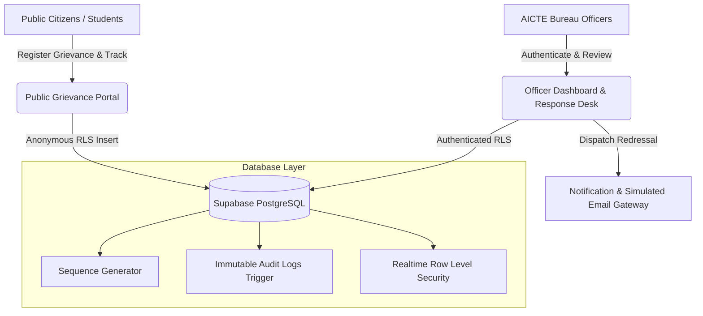

# AICTE Cross-Bureau Complaint Coordination Platform

[](https://aicte-complaint-montoring-dashbaord.vercel.app/)
[](https://www.sih.gov.in/)
[](https://reactjs.org/)
[](https://www.typescriptlang.org/)
[](https://vitejs.dev/)
[](https://tailwindcss.com/)
[](https://supabase.com/)

> 🌐 **Live Website:** [https://aicte-complaint-montoring-dashbaord.vercel.app/](https://aicte-complaint-montoring-dashbaord.vercel.app/)  
> **All India Council for Technical Education (AICTE)**  
> Ministry of Education, Government of India  
> Inter-Bureau Regulatory & Public Grievance Redressal Monitoring System

---

## 🏛️ Executive Summary

In technical education governance, grievances filed against approved institutions frequently span multiple autonomous directorates—including the **Regulation Bureau (RB)**, the **Public Grievance Redressal Cell (PGRC)**, the **Approval Bureau (AB)**, and the **Policy & Academic Planning Bureau (P&AP)**. 

Prior to this platform, disparate channels resulted in duplicate inquiries, siloed communication, lack of cross-bureau visibility, and conflicting directives to technical institutions.

This platform provides a centralized, authoritative portal designed specifically for:
1. **Public Grievance Intake**: Direct, frictionless submission for students, parents, and institutions without requiring internal portal authentication.
2. **Cross-Bureau Coordination**: Real-time cross-department case tracking, bilateral transfers, and synchronized regulatory actions.
3. **Official Response & Redressal Dispatch**: Direct officer reply workbench with simulated email transmission receipts and automated status updates.
4. **Tamper-Evident Accountability**: Cryptographically sequential case numbers and immutable audit logs enforced by PostgreSQL triggers.

---

## 🌟 Core Features

### 1. 🌐 Public Grievance Intake & Case Tracking Portal
- **Zero-Barrier Access**: Available publicly to students, faculty, parents, and institution heads.
- **Auto-Bureau Routing**: Grievances automatically route to the responsible bureau (`PGRC`, `RB`, `AB`, `P&AP`) based on AICTE regulatory categorization.
- **Live Status Tracking**: Complainants receive an official reference ID (e.g., `AICTE-2026-01051`) to track inquiry progress without exposing sensitive internal bureau notes.

### 2. 🛡️ Role-Based Bureau Officer Workspace
- **Executive Dashboard**: Real-time KPIs for Total Intake, Newly Received, Under Review, Active Inquiries, and Overdue SLA Targets.
- **Bureau Workload Breakdown**: Live aggregation across participating bureaus with clear clearance rate percentages.
- **Case Dossier Management**: Comprehensive case files displaying institution details, AICTE permanent IDs, regulatory violation clauses, and prior hearing history.

### 3. ✉️ Official Response & Redressal Dispatch Desk
- **Direct Redressal**: Officers compose formal directives, relief orders, hearing notices, or final closure reports directly from the desk.
- **Dispatch Receipt Generation**: Generates simulated email transmission notices to the complainant's email address and institution authorities.
- **Threaded Case History**: Preserves all prior regulatory correspondence and case updates.

### 4. 🔄 Inter-Bureau Assignment Desk
- Reassign cases or transfer desks between bureaus (e.g., PGRC transferring fee-cap violations to Regulation Bureau).
- Officer assignment and unassigned bureau pool management.

### 5. 🔒 Tamper-Evident Audit Trail
- Every regulatory action, status transition, and case reassignment is permanently committed to `audit_logs`.
- Protected by PostgreSQL database triggers (`trg_audit_immutability`) preventing any `UPDATE` or `DELETE` operations on historical audit records.

---

## 🏗️ Technical Architecture



### Technology Stack
- **Frontend**: React 19, TypeScript, Vite, Tailwind CSS, Lucide React Icons
- **Backend & Database**: Supabase PostgreSQL with Row Level Security (RLS), Database Triggers, Sequences, and Functions
- **Hosting & CI/CD**: Vercel Continuous Deployment

---

## 📂 Project Structure

```text
├── public/                     # Static assets & routing redirect configs
│   └── _redirects              # Netlify SPA routing rules
├── src/
│   ├── components/common/      # Government-styled Header, Sidebar, Badges
│   ├── context/                # Authentication context & demo session provider
│   ├── features/
│   │   ├── admin/              # User role & privilege administration
│   │   ├── assignments/        # Bureau desk reallocation workbench
│   │   ├── audit/              # Tamper-evident audit trail viewer
│   │   ├── complaints/         # Intake form, registry, dossier, & response desk
│   │   ├── dashboard/          # Bureau workload metrics & live KPI widgets
│   │   ├── overlap-engine/     # AI Semantic Overlap Engine Architecture & PRD
│   │   └── reports/            # Performance analytics & SLA compliance charts
│   ├── pages/
│   │   ├── Login.tsx           # Official government officer login portal
│   │   └── PublicGrievancePortal.tsx # Public student/institution intake portal
│   ├── services/supabase/      # Type-safe Supabase database service layer
│   └── types/                  # PostgreSQL schema database types
├── supabase/
│   └── migrations/             # SQL schemas, RLS policies, triggers & seeds
├── vercel.json                 # Vercel SPA routing configuration
└── vite.config.ts              # Vite build setup
```

---

## 🚀 Getting Started Locally

### Prerequisites
- [Node.js](https://nodejs.org/) (v18 or higher recommended)
- [npm](https://www.npmjs.com/)

### 1. Clone the Repository
```bash
git clone https://github.com/austin2007/AICTE-Complaint-Montoring-Dashbaord-SIH-.git
cd AICTE-Complaint-Montoring-Dashbaord-SIH-
```

### 2. Install Dependencies
```bash
npm install
```

### 3. Environment Configuration
Create a `.env` file in the root directory:
```env
VITE_SUPABASE_URL=https://your-supabase-id.supabase.co
VITE_SUPABASE_PUBLISHABLE_KEY=your-supabase-anon-key
VITE_PORTAL_NAME=AICTE Cross-Bureau Complaint Coordination Platform
VITE_SIH_PROBLEM_ID=26264
```

### 4. Run the Development Server
```bash
npm run dev
```
Open [http://localhost:3000](http://localhost:3000) in your browser.

### 5. Production Build
```bash
npm run build
```

---

## 🔑 Demo Officer Profiles

For testing and demonstration, the platform includes quick 1-click logins on the Officer Login page:

| Role | Officer Name | Department / Bureau | Official Email |
| :--- | :--- | :--- | :--- |
| **Administrator** | Dr. R. K. Sharma | Central Administration & Vigilance | `admin@aicte.gov.in` |
| **Bureau Officer** | Smt. Sunita Verma | Regulation Bureau (RB) | `rb.officer@aicte.gov.in` |
| **Bureau Officer** | Shri Arvind Nair | Public Grievance Redressal Cell (PGRC) | `pgrc.officer@aicte.gov.in` |
| **Cross-Dept Reviewer** | Dr. Meenakshi Sundaram | Approval Bureau (AB) | `reviewer@aicte.gov.in` |

*Default Password for all demo accounts:* `Aicte@Admin2026` *(or click the 1-click Instant Demo Access button)*.

---

## 📜 Compliance & Security

- **NIC & AICTE Design Standard**: Government tricolor accent, official deep-navy (#0b3b60) branding, high-contrast typography.
- **Row Level Security (RLS)**: Public intake permitted while internal assignment, user management, and audit logs are strictly protected.
- **Non-Repudiation**: Automatic assignment history logging and immutable system records prevent unauthorized case tampering.

---

## 📄 License

This project is licensed under the [MIT License](LICENSE).  
Developed for the **Smart India Hackathon (Problem Statement ID: 26264)**.
