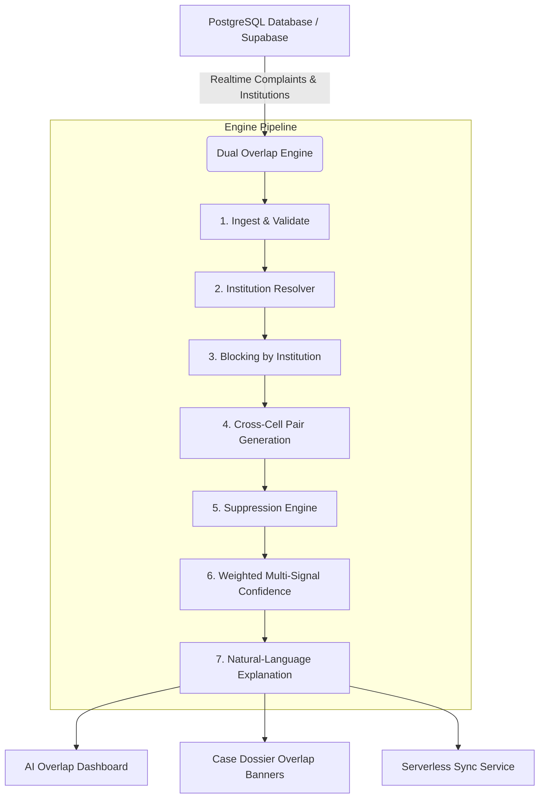

# AICTE Cross-Bureau Overlap Intelligence Engine

> **Status:** Fully Integrated & Operational (SIH Problem Statement ID: 26264)  
> **Engine Core:** Standalone Standard-Library Python Engine + Real-Time Client-Side TypeScript Port

---

## 1. Overview & Problem Definition

In multi-departmental governance environments like AICTE, multiple bureaus (Regulation Bureau [RB], Public Grievance Redressal Cell [PGRC], Approval Bureau [AB], and Policy Bureau) receive complaints concerning the same technical institution.

Two cases are classified as a **Potential Cross-Bureau Overlap** when:
1. They concern the **same technical institution** (resolved via AICTE permanent ID, exact name, alias, or fuzzy token alignment).
2. They are being concurrently handled by **different Bureaus / Cells** (e.g., `RB` and `PGRC`).

Text similarity, category alignment, and temporal recency raise or lower the **confidence score** ($0.0 - 1.0$), generating actionable alerts for bureau officers before conflicting regulatory directives or duplicate investigations occur.

---

## 2. Integrated Architecture



---

## 3. Scoring Formula & Signal Weights

The confidence score is computed as:

$$\text{Confidence} = \text{inst\_conf} \times \frac{\sum w_i \cdot s_i}{\sum w_i}$$

| Signal ($s_i$) | Weight ($w_i$) | Description |
| :--- | :---: | :--- |
| **Base Entity Match** | $0.40$ | Both complaints concern the same institution across different cells. |
| **Text Similarity** | $0.30$ | TF-IDF / Token Jaccard similarity across complaint titles & allegations. |
| **Category Alignment** | $0.20$ | Identical regulatory categories ($1.0$) vs related ($0.5$) vs distinct ($0.0$). |
| **Temporal Proximity** | $0.10$ | Recency decay over a 90-day window: $\max(0, 1.0 - \text{days} / 90)$. |

The engine reports a numeric match score for each detected overlap. Scores are used to order alerts and are not divided into high, medium, or low confidence categories.

---

## 4. Suppression Rules (Auditable Transparency)

Pairs meeting any of the following criteria are suppressed from the active alert queue:
1. **`already_linked`**: Cases previously marked as coordinated by an AICTE officer.
2. **`dismissed_by_officer`**: Human-in-the-loop audit determination marking the pair as distinct.
3. **`closed_case`**: Either case is in a terminal state (`Resolved`, `Closed`, `Disposed`).
4. **`below_min_confidence`**: Confidence score strictly below threshold ($< 30\%$).

---

## 5. Execution & Verification

### Python Standalone CLI Sync
Run the batch sync service directly against the live Supabase repository:

```bash
python3 overlap-engine/sync_service.py
```

### Interactive UI Dashboard
Navigate to **AI Overlap Engine** in the sidebar to:
- Inspect active cross-bureau conflicts.
- Perform side-by-side case comparisons.
- Link cases for joint inquiry coordination.
- View real-time alert banners directly inside individual case dossiers.
